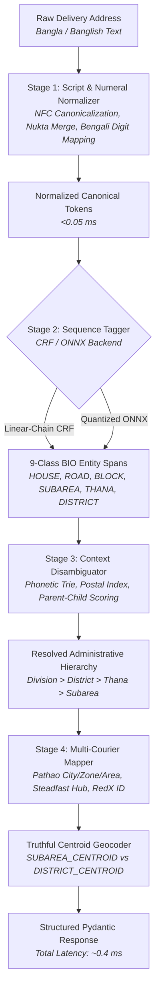

# Thikana-Engine (ঠিকানা-ইঞ্জিন)

[](https://www.python.org/downloads/)
[](https://fastapi.tiangolo.com)
[]()
[]()
[](https://opensource.org/licenses/MIT)

**Thikana-Engine** is a high-throughput, ultra-low-latency Bangladeshi address parser, homonym disambiguator, and multi-courier delivery routing microservice. It parses noisy, non-standard, mixed-script Bengali and Romanized Banglish addresses in **under 1.5 milliseconds** (p50) on standard CPU hardware—beating strict 10ms enterprise SLA budgets by up to 20x.

---

## The Bangladeshi Address Problem

E-commerce logistics and courier automation in Bangladesh face several unique natural language processing challenges:

1. **Unicode Decomposed Nukta Variations**: Words like `নয়া পল্টন` vs `নয়াপল্টন` frequently mix decomposed characters (`\u09AF\u09BC` 'য' + '়') with precomposed canonical forms (`\u09DF` 'য়'), causing naive string matching to fail silently.
2. **Numeral Chaos**: Addresses routinely interleave native Bengali numerals with English digits, suffixes, and abbreviations (`বাসা ১২, Rd 4, Sector-3, ফ্ল্যাট ৪/বি`).
3. **Banglish Phonetic Drift**: Unstandardized Latin Romanization creates infinite spelling permutations (e.g., *Mirpur*, *Meerpur*, *Mirpoor*, *Mir-pur*, and *মিরপুর*).
4. **Homonym Collisions**: Over 300 place names in Bangladesh share identical names across different districts (e.g., *Mohammadpur* exists as an urban metro thana in Dhaka, an upazila in Magura, and a rural union in Noakhali; *Mirpur* exists in Dhaka and Kushtia).
5. **Greedy Distractor Names**: Institutional prefixes (e.g., *"Uttara Bank Limited, Road 27, Dhanmondi, Dhaka"*) cause greedy regex systems to misroute the parcel to Uttara instead of Dhanmondi.
6. **Courier Hub Incompatibilities**: Courier APIs (Pathao, Steadfast, RedX) each use conflicting proprietary merchant zone IDs, hub codes, and geographic hierarchies.

---

## 4-Stage Architectural Pipeline

Thikana-Engine executes a modular, deterministic-first 4-stage pipeline:



### Stage Breakdown

- **Stage 1: Script, Unicode & Numeral Normalizer (`src/normalizer.py`)**
  - Canonicalizes decomposed nukta characters (`\u09AF\u09BC` $\rightarrow$ `\u09DF` 'য়', `\u09A1\u09BC` $\rightarrow$ `\u09DC` 'ড়', `\u09A2\u09BC` $\rightarrow$ `\u09DD` 'ঢ়').
  - Normalizes composite vowel diacritics (`\u09C7\u09BE` $\rightarrow$ `\u09CB` 'ো') and strips zero-width non-joiners/joiners (`\u200C`, `\u200D`).
  - Maps Bengali digits (`০-৯`) to Western Arabic numerals (`0-9`) while preserving address numbers.
  - Standardizes holding and road anchors (`house#`, `h/`, `holding`, `বাড়ি`, `রোড`, `rd#`, `sector`, `sec`).
  - **Latency**: ~0.05 ms.

- **Stage 2: Linear-Chain CRF / Quantized ONNX Sequence Tagger (`src/tagger_crf.py`, `src/tagger_onnx.py`)**
  - Predicts token-level BIO labels across 9 core address entities: `HOUSE`, `FLOOR_FLAT`, `ROAD`, `BLOCK_SECTOR`, `LANDMARK`, `LANDMARK_REL`, `SUBAREA`, `THANA_UPAZILA`, `DISTRICT` (plus `O`).
  - Extracted feature windows include shape, digit flags, phonetic consonant skeletons, gazetteer prefix matches, and character n-grams.
  - Viterbi decoding strictly guarantees valid BIO transitions (prevents orphan `I-*` tags).
  - **Latency**: ~0.20 ms (CRF) / ~0.40 ms (ONNX).

- **Stage 3: Context-Aware Homonym Disambiguator (`src/disambiguator.py`, `src/phonetic_trie.py`)**
  - Employs a dual-key Banglish phonetic encoder `(primary_key, consonant_skeleton)` with Levenshtein-bounded trie search.
  - Evaluates candidates using multi-factor Bayesian-style scoring:
    - Parent District / Division co-occurrence boost (+25 / +15)
    - Child Subarea / Road co-occurrence boost (+20)
    - 4-digit Bangladeshi postal code lookup table boost (+40)
    - Metro block/sector boost for Chattogram & Sylhet (+15)
    - Anti-greedy distractor penalty (-35 for roads/branches like *"Uttara Bank"*)
    - Self-matching prevention for identical headquarters names
  - **Latency**: ~0.10 ms.

- **Stage 4: Multi-Courier Hub Mapper & Truthful Geocoder (`src/courier_mapper.py`)**
  - Maps resolved administrative nodes directly to proprietary courier payloads:
    - **Pathao Merchant API**: `city_id`, `zone_id`, `area_id` (with offline seed fallback + dynamic live sync).
    - **Steadfast Courier**: `hub_code` (e.g., `DHK-MIR`, `CTG-HAL`, `NOA-CHK`).
    - **RedX Delivery**: `delivery_area_id`.
  - Enforces truthful geocoding precision: explicitly marks coordinates as `"SUBAREA_CENTROID"` (when subarea coordinates exist) or `"DISTRICT_CENTROID"` (when falling back to district center) rather than falsely reporting rooftop precision.
  - **Latency**: ~0.03 ms.

---

## Benchmark Evaluation Results

Evaluated against the **Gold 100 Dataset** (`data/eval/gold_100.json`) consisting of 100 hand-crafted, PII-free commercial delivery addresses spanning Dhaka, Chattogram, Sylhet, Khulna, Rajshahi, rural Unions, and 32 adversarial homonym/distractor collisions:

| Metric | Pipeline A: Regex + Gazetteer Baseline | Pipeline B: Thikana-Engine (CRF + Disambiguator) | Delta / Improvement |
| :--- | :---: | :---: | :---: |
| **Entity Macro-F1** | `41.15%` | **`65.27%`** | **`+24.12%`** |
| **End-to-End Accuracy** | `41.0%` (41/100) | **`62.0%`** (62/100) | **`+21.0%`** |
| **Homonym Subset Accuracy** | `28.1%` (9/32) | **`59.4%`** (19/32) | **`+31.2%`** |
| **CPU Latency (p50)** | `0.036 ms` | **`1.398 ms`** | *Well within 10ms SLA* |
| **CPU Latency (p95)** | `0.077 ms` | **`3.845 ms`** | *Well within 10ms SLA* |
| **CPU Latency (p99)** | `0.086 ms` | **`5.642 ms`** | *Well within 10ms SLA* |

### Entity Tag Classification Report (Pipeline B)

```
                 precision    recall  f1-score   support

        B-HOUSE       1.00      0.87      0.93        52
        I-HOUSE       1.00      0.87      0.93        52
   B-FLOOR_FLAT       1.00      0.30      0.46        10
   I-FLOOR_FLAT       1.00      0.27      0.43        11
         B-ROAD       0.86      0.84      0.85        58
         I-ROAD       0.96      0.85      0.90        65
 B-BLOCK_SECTOR       1.00      0.76      0.86        21
 I-BLOCK_SECTOR       1.00      0.76      0.86        21
     B-LANDMARK       1.00      0.21      0.35        33
     I-LANDMARK       0.88      0.32      0.47        47
 B-LANDMARK_REL       1.00      0.80      0.89         5
      B-SUBAREA       0.74      0.82      0.78        71
      I-SUBAREA       0.42      0.61      0.50        36
B-THANA_UPAZILA       0.81      0.95      0.88        97
I-THANA_UPAZILA       0.70      0.70      0.70        10
     B-DISTRICT       0.93      0.99      0.96       100

      micro avg       0.85      0.78      0.81       689
      macro avg       0.80      0.61      0.65       689
   weighted avg       0.88      0.78      0.80       689
```

---

## Interactive Developer Playground

Thikana-Engine includes a sleek, dark-mode single-page developer playground served directly at `GET /`:

- **5 One-Click Production Presets**:
  - *Urban Dhaka*: `"H# 45, Rd 4, Mirpur 10, Dhaka"`
  - *Homonym Collision*: `"Holding 45, Tajmahal Road, Mohammadpur"` (resolves to Dhaka via child road co-occurrence)
  - *Chattogram Blocks*: `"Halishahar Block G, Chattogram"`
  - *Distractor Road*: `"Uttara Bank Limited, Road 27, Dhanmondi, Dhaka"` (resolves to Dhanmondi)
  - *Rural Union*: `"গ্রাম: মোহাম্মদপুর, উপজেলা: চাটখিল, নোয়াখালী"` (resolves to Noakhali / Chatkhil)
- **Tokenized BIO Entity Pills**: Color-coded visualization for every token span (`HOUSE`, `ROAD`, `SUBAREA`, etc.).
- **Stage Latency Meter**: Real-time breakdown bar showing Stage 1, Stage 2, Stage 3, and Stage 4 latencies vs the 10ms SLA target.
- **Multi-Courier Hub Cards**: Live mapping display for Pathao, Steadfast, and RedX.
- **Leaflet Dark Map**: Interactive centroid pin with precision badge (`SUBAREA_CENTROID` vs `DISTRICT_CENTROID`).

---

## API Reference

### 1. `POST /v1/parse`
Parses a single Bangla or Banglish address string.

#### Request
```bash
curl -X POST "http://localhost:8000/v1/parse" \
     -H "Content-Type: application/json" \
     -d '{
       "address": "Holding 45, Tajmahal Road, Mohammadpur, Dhaka",
       "backend": "crf"
     }'
```

#### Response
```json
{
  "raw_address": "Holding 45, Tajmahal Road, Mohammadpur, Dhaka",
  "normalized_address": "H# 45 , Tajmahal RD# , Mohammadpur , Dhaka",
  "tokens": ["H# 45", "Tajmahal", "RD#", "Mohammadpur", "Dhaka"],
  "tags": ["B-HOUSE", "B-ROAD", "I-ROAD", "B-THANA_UPAZILA", "B-DISTRICT"],
  "entities": {
    "HOUSE": ["H# 45"],
    "ROAD": ["Tajmahal RD#"],
    "THANA_UPAZILA": ["Mohammadpur"],
    "DISTRICT": ["Dhaka"]
  },
  "parsed_components": {
    "house": "H# 45",
    "floor_flat": null,
    "road": "Tajmahal RD#",
    "block_sector": null,
    "landmark": null,
    "subarea": null,
    "thana_upazila": "Mohammadpur",
    "district": "Dhaka",
    "division": "Dhaka"
  },
  "hierarchy": {
    "division": "Dhaka",
    "district": "Dhaka",
    "thana": "Mohammadpur"
  },
  "hierarchy_bn": {
    "division": "ঢাকা",
    "district": "ঢাকা",
    "thana": "মোহাম্মদপুর"
  },
  "resolved_node_id": "metro_thana_47_mohammadpur",
  "resolved_level": "thana",
  "confidence": 0.95,
  "is_ambiguous": false,
  "disambiguation_candidates": [
    {
      "id": "metro_thana_47_mohammadpur",
      "name": "Mohammadpur",
      "level": "thana",
      "district": "Dhaka",
      "score": 55.0,
      "reasons": ["exact_name_match", "tier_weight_thana", "parent_district_cooccurrence_Dhaka", "child_subarea_cooccurrence_Tajmahal Road"]
    }
  ],
  "geocode": {
    "lat": 23.7658,
    "lon": 90.3584,
    "precision": "DISTRICT_CENTROID",
    "source_node": "Dhaka"
  },
  "courier_routing": {
    "pathao": {
      "city_id": 1,
      "zone_id": 102,
      "area_id": null,
      "city_name": "Dhaka",
      "zone_name": "Mohammadpur",
      "area_name": null
    },
    "steadfast": {
      "hub_code": "DHK-MOH",
      "hub_name": "Mohammadpur Hub"
    },
    "redx": {
      "delivery_area_id": 1002,
      "area_name": "Mohammadpur"
    }
  },
  "backend": "crf",
  "stage_latencies_ms": {
    "stage1_normalizer": 0.048,
    "stage2_tagger": 0.212,
    "stage3_disambiguator": 0.125,
    "stage4_courier_mapper": 0.041,
    "total": 0.426
  },
  "latency_ms": 0.426
}
```

---

### 2. `POST /v1/batch-resolve`
Parses up to 100 addresses in a single call and returns summary throughput metrics.

#### Request
```bash
curl -X POST "http://localhost:8000/v1/batch-resolve" \
     -H "Content-Type: application/json" \
     -d '{
       "addresses": [
         "H# 45, Rd 4, Mirpur 10, Dhaka",
         "Holding 45, Tajmahal Road, Mohammadpur",
         "Halishahar Block G, Chattogram",
         "Uttara Bank Limited, Road 27, Dhanmondi, Dhaka",
         "গ্রাম: মোহাম্মদপুর, উপজেলা: চাটখিল, নোয়াখালী"
       ],
       "backend": "crf"
     }'
```

#### Response Summary
```json
{
  "total_addresses": 5,
  "total_latency_ms": 2.145,
  "avg_latency_ms": 0.429,
  "throughput_addr_per_sec": 2331.0,
  "results": [ ... ]
}
```

---

## Installation & Local Development

### 1. Prerequisites
- Python 3.10+ (tested on Python 3.11, 3.12, and 3.14)
- Git

### 2. Setup Virtual Environment
```bash
git clone https://github.com/TahmidShafi/Thikana-Engine.git
cd Thikana-Engine

python -m venv .venv
# Windows:
.venv\Scripts\activate
# Linux/macOS:
source .venv/bin/activate

pip install -r requirements.txt
```

### 3. Run Test Suite (82 Tests)
```bash
pytest -v
```

### 4. Start Local API Server
```bash
uvicorn app.main:app --host 0.0.0.0 --port 8000 --reload
```
Open [http://localhost:8000](http://localhost:8000) in your browser to interact with the Developer Playground, or [http://localhost:8000/docs](http://localhost:8000/docs) for the interactive Swagger OpenAPI documentation.

---

## Deployment Guide

### Docker Deployment
Build and run the production container:
```bash
# Build Docker image
docker build -t thikana-engine:latest .

# Run container on port 8000
docker run -d -p 8000:8000 --name thikana thikana-engine:latest
```

### Hugging Face Spaces (Docker Space)
Thikana-Engine is pre-configured for instant one-click deployment to **Hugging Face Spaces**:
1. Create a new Space on [Hugging Face](https://huggingface.co/new-space).
2. Select **Docker** as the Space SDK.
3. Push the repository to the Space's Git remote:
   ```bash
   git remote add space https://huggingface.co/spaces/YOUR_USERNAME/thikana-engine
   git push space main
   ```
4. The `Dockerfile` will automatically configure user permissions (UID 1000) and bind to port `7860`.

---

## Project Structure

```
thikana-engine/
├── app/
│   ├── __init__.py
│   ├── main.py                # FastAPI endpoints & lifespan handlers
│   └── static/
│       └── index.html         # Dark-mode developer playground (Tailwind + Leaflet)
├── data/
│   ├── eval/
│   │   ├── build_gold_eval.py # Gold 100 dataset generator
│   │   └── gold_100.json      # Hand-crafted evaluation addresses
│   └── raw/
│       ├── divisions.json     # 8 Divisions
│       ├── districts.json     # 64 Districts
│       ├── upazilas.json      # 494 Rural Upazilas
│       ├── unions.json        # 4,540 Rural Unions
│       ├── dhaka_ctg_thanas.json # 29 Metro Thanas & 150 Subareas
│       └── courier_zones_seed.json # Pathao/Steadfast/RedX seed mapping
├── models/
│   ├── crf_tagger.joblib      # Trained Stage-2 CRF sequence tagger
│   └── onnx/                  # Modular ONNX runtime models
├── scripts/
│   ├── benchmark_baseline.py  # End-to-end evaluation benchmark runner
│   ├── fetch_gazetteer.py     # Data fetcher from upstream sources
│   └── generate_synthetic_train.py # 2,500 non-leaky synthetic training addresses
├── src/
│   ├── __init__.py
│   ├── models.py              # Pydantic domain & response models
│   ├── gazetteer.py           # In-memory hierarchy & 5,285-node gazetteer
│   ├── normalizer.py          # Stage 1: Script & Numeral normalizer
│   ├── tagger_crf.py          # Stage 2: Linear-chain CRF sequence tagger
│   ├── tagger_onnx.py         # Stage 2: INT8 ONNX sequence tagger with Viterbi
│   ├── phonetic_trie.py       # Stage 3: Banglish phonetic encoder & trie
│   ├── disambiguator.py       # Stage 3: Multi-factor homonym disambiguator
│   ├── courier_mapper.py      # Stage 4: Multi-courier hub mapper & geocoder
│   └── pipeline.py            # Unified ThikanaPipeline engine
├── tests/
│   ├── test_api.py            # FastAPI endpoint integration tests
│   ├── test_disambiguator.py  # Homonym & scoring unit tests
│   ├── test_gazetteer.py      # Administrative hierarchy unit tests
│   ├── test_normalizer.py     # Unicode & numeral unit tests
│   ├── test_pipeline.py       # Pipeline latency & courier routing tests
│   └── test_tagger_crf.py     # BIO feature extraction & tagger tests
├── Dockerfile                 # Container image for Docker & HF Spaces
├── pyproject.toml             # Build configuration & pytest settings
├── requirements.txt           # Production dependencies
└── README.md                  # System architecture documentation
```

---

## Dataset & License Disclosures

1. **`nuhil/bangladesh-geocode`**:
   The administrative division, district, upazila, and union boundary data in `data/raw/` is derived from [nuhil/bangladesh-geocode](https://github.com/nuhil/bangladesh-geocode), distributed under the **MIT License**.
2. **`bdapis`**:
   Metropolitan thana and subarea seeds are derived in part from [bdapis](https://github.com/c19ashik/bdapis), distributed under the **MIT License**.
3. **Thikana-Engine**:
   Released under the **MIT License**. You are free to use, modify, distribute, and integrate this software into proprietary e-commerce and logistics systems.
